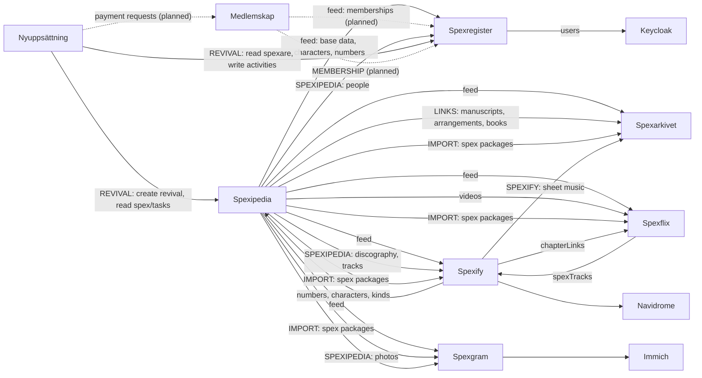

# FGV data ownership

Status: agreed 2026-11-19. This page says which application is the **master** of each kind of information, which
applications keep copies, and how they talk to each other. Editors' version, in Swedish: [var-ligger-vad.md](var-ligger-vad.md).

## 1. The rule

1. **One master.** Every kind of information is created and edited in exactly one application, its master.
2. **Copies are read-only.** Another application that needs it either asks the master when it needs it (a live call),
   or keeps a read-only copy that only a sync writes, by the master's UUID. Nobody edits a copy.
3. **Ändra i \<app\>.** Wherever an application shows information it does not master, it shows a link to the place in
   the master where it is edited (*Ändra i Spexipedia*, *Ändra i Spexify* …), to users who may edit there.
4. **References, not names.** A person is referred to by their spexare UUID in Spexregister. Names and contact details
   are never copied out of Spexregister. Free-text names are only for people outside FGV, or for credits "as printed"
   / "as shown on screen" on a given piece of material.
5. **The thing and its catalogue entry live together.** The application that holds an item also holds what describes
   it: records (with or without audio) in Spexify, books (with or without a scan) in Spexarkivet, videos in Spexflix,
   photos of people in Spexgram.
6. **A new kind of information** gets a master before it gets a table. Add it to this page first.

## 2. Masters

| Master | Information (edited only here) | Who copies or reads it, and how |
|---|---|---|
| **Spexipedia** | Spex categories, spex, revivals (a spex with a parent), task categories, tasks (with *board*), characters, scenes, **numbers** (act, position, title, kind, original song, first line, credits, who sings it), revival changes, spex pages and their own images (no people), facts, wiki articles, kinds (number, credit, image, fact) | Change feed (`SYNC`): Spexregister (all base data and characters), Spexarkivet (spex, numbers, characters, tasks → instruments), Spexify (spex, categories, numbers with kind and credits), Spexflix and Spexgram (spex, categories). Live: Nyuppsättning (spex, tasks), Spexify (numbers, characters, kinds) |
| **Spexregister** | Spexare and their addresses, consents, tags, images and locations; activities (who did which task in which spex, who played which character); external (CING) memberships; users and permissions; news | Live only, never copied: Spexipedia (`SPEXIPEDIA`: participants, names/nicknames of published spexare), Nyuppsättning (`REVIVAL`), Medlemskap (`MEMBERSHIP`, planned) |
| **Medlemskap** (planned; accounts first) | Internal (FGV) memberships, fees, payment requests and reports, bank imports, payments, refunds, applications, reminders; the *administration* of accounts: registration, and who may use which application with which roles (the accounts themselves, passwords and sessions stay in Keycloak) | Feed `membershipChanges` (`SYNC`): Spexregister keeps a read-only copy of PAID and WAIVED memberships |
| **Spexarkivet** | Manuscripts and other documents with their kinds; **books** (spex books, songbooks, anniversary books: volume, year, cover, song list → numbers, words-only flag; a book may have no scan yet); arrangements (→ number), material versions, files, own instruments, shares and access requests | Live: Spexify (`SPEXIFY`: sheet music by number id), Spexipedia (`LINKS`: manuscripts, arrangements, books by spex and number) |
| **Spexify** | **Albums**, which are FGV's discography: title, kind, medium, catalogue number, released, recorded, covers, conductor, spex (an album may have no audio yet); tracks (→ number, performers, audio); the **sung lyrics** with timing and history; score sync maps; playlists and listening | Live: Spexipedia (`SPEXIPEDIA`: discography and *Listen*), Spexflix (`spexTracks` for chapters) |
| **Spexflix** | Videos, renditions, subtitles, chapters (→ Spexify track), video credits as shown on screen, video kinds, collections, playlists, watching | Live: Spexify (`chapterLinks`: *Watch in Spexflix*), Spexipedia (`spexipediaVideos`) |
| **Spexgram** | Albums of photos and short videos of people, items (stored in Immich), album kinds, contributions, moderation | Live: Spexipedia (`SPEXIPEDIA`: picked items, albums of a spex) |
| **Nyuppsättning** | The revival *project*: members and their capabilities, participants (→ spexare), pending people (until they are spexare), responses, shifts, fees, budget, events, guide, meetings, decision log, mailings, news | Writes at closing: the revival spex in Spexipedia (`REVIVAL`), activities in Spexregister (`REVIVAL`); later payment requests in Medlemskap |
| **Keycloak** (`fgv-keycloak`) | Accounts, clients and roles; sample users in `sample-users.tsv` here | Every application |

### 2.1 Easily confused

| Looks like | Is really | Master |
|---|---|---|
| A number on a Spexify track, a Spexarkivet arrangement or a Spexflix chapter | A reference to Spexipedia's number | Spexipedia |
| *Lyrics by / music by / arranged by* on a Spexify track that is linked to a number | The number's credits, shown read-only | Spexipedia |
| *Arranged by* on a version in Spexarkivet | Who arranged that version, as printed on it | Spexarkivet |
| The lyrics of a track | What was sung on that recording, with timing | Spexify |
| A record (LP, EP, CD, digital) on a spex page | A Spexify album, shown read-only | Spexify |
| A spex book on a number in Spexipedia | A Spexarkivet book, shown read-only | Spexarkivet |
| *Played by* / board / tasks on a spex page | Spexregister activities, fetched when the page is shown | Spexregister |
| A photo of people on a spex page | A Spexgram item | Spexgram |
| A sketch, poster, scenography image | Spexipedia's own image (shows no people) | Spexipedia |
| A revival in Nyuppsättning | The planning project; the revival as a spex is in Spexipedia | Nyuppsättning / Spexipedia |
| News in Spexregister and in Nyuppsättning | Two separate news lists for two audiences | Each its own |
| Spex, categories, tasks in Spexregister | A read-only copy from Spexipedia | Spexipedia |
| FGV memberships in Spexregister | A read-only copy from Medlemskap (CING memberships are Spexregister's own) | Medlemskap |

## 3. How the applications talk

### 3.1 Feeds

| Feed | Master | Followers | What | How |
|---|---|---|---|---|
| `baseDataChanges` | Spexipedia | Spexregister, Spexarkivet, Spexify, Spexflix, Spexgram | Spex categories, spex, task categories, tasks, characters, numbers | GraphQL, `SYNC`; pull every 5 min from a cursor; `POST /api/sync/notify` from Spexipedia to pull at once; `UPSERT`, `RETIRE`, `MERGE` |
| `membershipChanges` (planned) | Medlemskap | Spexregister | PAID and WAIVED FGV memberships | Same pattern |

A follower applies a page of changes in one transaction. When that fails it applies them one at a time; a change that
still fails at five pulls in a row is recorded as skipped and left out, so that it cannot hold up the changes after
it. Admins see the skipped changes on the follower's maintenance page: the copy lacks them until the record is changed
again in the master (or, in Spexregister and Spexarkivet, the whole feed is pulled again).

### 3.2 Copies

| Application | Copy tables | From |
|---|---|---|
| Spexregister | `spex_category`, `spex`, `spex_details`, `task_category`, `task`, `spex_character`; `membership` (FGV, planned) | Spexipedia feed; Medlemskap feed |
| Spexarkivet | `spex`, `number`, `spex_character`, `spexipedia_task_category`, `spexipedia_task`, `spexipedia_category`; `instrument` rows with `task_id` | Spexipedia feed |
| Spexify | `album_spex`, `album.spex_*`, `spexipedia_category`, `track.number_*` (id, title, kind); a number's credits only in memory, ≤ 10 min | Spexipedia feed; `numbersByIds` |
| Spexflix | `video_spex`, `spexipedia_category`; `chapter.spexify_track_title` | Spexipedia feed; Spexify |
| Spexgram | `album_spex`, `spexipedia_category` | Spexipedia feed |
| Nyuppsättning | none (in-memory caches only) | — |

### 3.3 Live calls

| Caller → callee | Role | For |
|---|---|---|
| Spexipedia → Spexregister | `SPEXIPEDIA` | Participants, board, *played by*, credits, *worn by*; picking credits (published spexare only, cached ≤ 10 min) |
| Spexipedia → Spexify | `SPEXIPEDIA` | Discography of a spex, tracks of numbers (*Listen*) |
| Spexipedia → Spexarkivet | `LINKS` | Manuscripts, arrangements, books of a spex and its numbers |
| Spexipedia → Spexflix | `SPEXIPEDIA` | Videos of a spex |
| Spexipedia → Spexgram | `SPEXIPEDIA` / public | Picked items, albums of a spex |
| Spexipedia → Spexarkivet, Spexify, Spexflix, Spexgram | `IMPORT` | Spex packages |
| Spexify → Spexipedia | `SYNC` | Numbers with their credits (names as a logged-in user sees them, cached ≤ 10 min, never stored), characters, number kinds |
| Spexify → Spexarkivet | `SPEXIFY` | Sheet music by number id |
| Spexify → Spexflix | `SPEXIFY` | Chapters linked to tracks |
| Spexflix → Spexify | `SPEXFLIX` | Tracks of a spex, for chapters |
| Nyuppsättning → Spexipedia | `REVIVAL` | Read spex and tasks; create the revival |
| Nyuppsättning → Spexregister | `REVIVAL` | Read spexare; at closing create spexare, activities |
| Medlemskap → Spexregister (planned) | `MEMBERSHIP` | Read spexare; create a spexare for an accepted application |
| fgv-content-migration → all | `IMPORT`, `SYNC` | One-time migration through each master's import API |

## 4. Known gaps

- Nyuppsättning still records the FGV membership of participants with Spexregister's `membershipCreate`. In the
  target, it creates a payment request in Medlemskap, and Spexregister gets the membership from Medlemskap's feed.
  This waits for Medlemskap M1.
- Spexflix's video credits are free text "as shown on screen", not spexare references.
- Changes to follow from this page (2026-11-19): Spexipedia's recordings move to Spexify albums, Spexipedia's books
  move to Spexarkivet, Spexify tracks take their credits from the number, Spexarkivet drops the number's old
  lyricist and composer columns (servers done 2026-11-19), and every web gets *Ändra i \<app\>* links.
